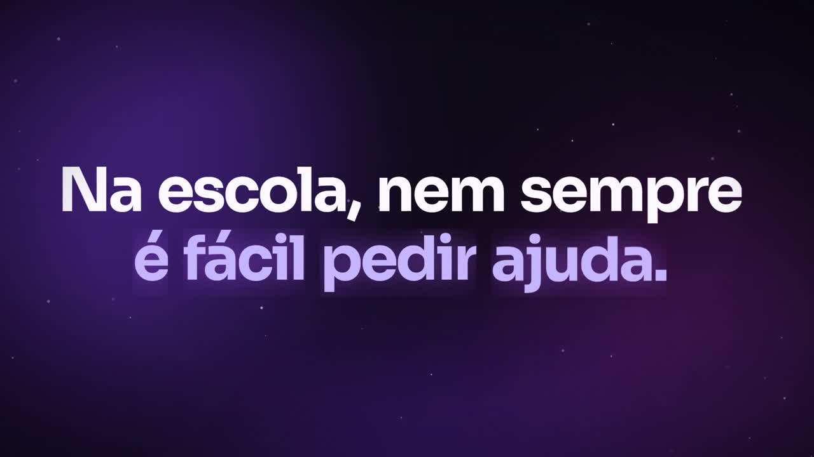
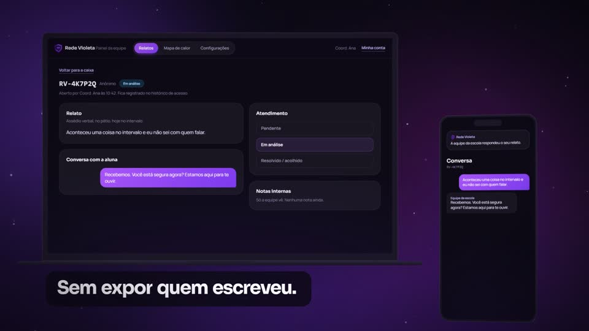
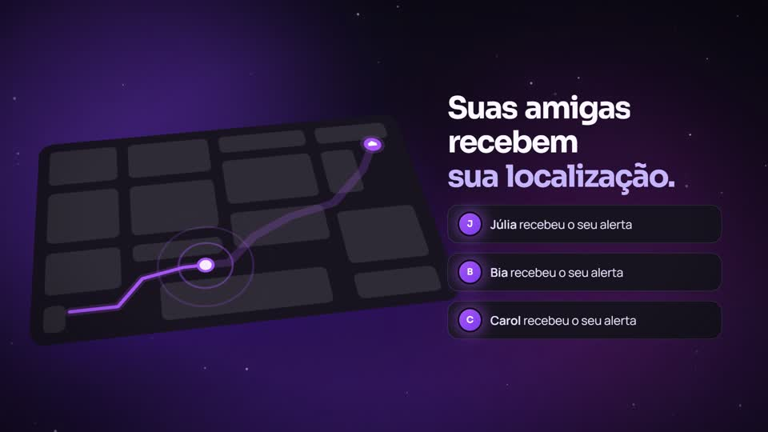
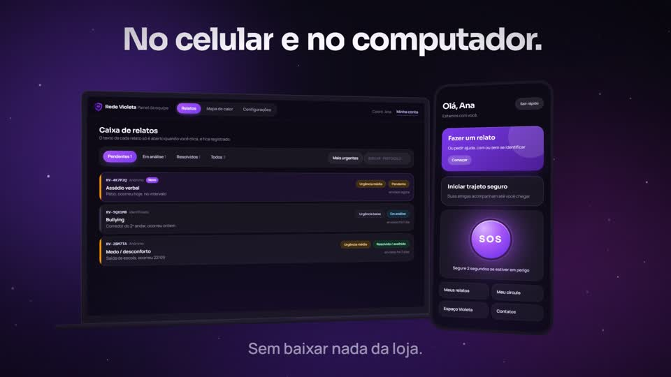

# Rede Violeta

App de segurança para alunas, com painel para a escola: contar o que aconteceu, pedir ajuda num perigo e voltar para casa acompanhada. O código é privado porque o projeto lida com relatos e alertas sensíveis.

**[Conhecer o projeto](https://rede-violeta.netlify.app)**

*Clique na imagem para assistir ao vídeo de apresentação (38 s). Todas as telas usam dados fictícios.*

## Para as alunas

- **Relato em três perguntas:** o que aconteceu, onde e quando, anônimo ou com nome
- **Protocolo e PIN:** no relato anônimo, permitem voltar à conversa sem revelar quem escreveu
- **SOS:** segurar o botão por 2 segundos avisa as amigas do círculo com a localização
- **Trajeto seguro:** as amigas acompanham o caminho no mapa até a chegada
- **Círculo de amigas:** de 2 a 5 pessoas de confiança, convidadas por código
- **Espaço Violeta:** textos curtos sobre assédio, relacionamento abusivo e direitos
- **Contatos de emergência** e **saída rápida**, que troca a tela se alguém chegar perto

## Para a escola

- **Caixa de relatos** com protocolo, tipo, local, urgência e situação
- **Conversa com a aluna** e notas internas, visíveis só para a equipe
- **Mapa de calor** de locais, tipos e períodos, para agir antes
- **Registro de acesso:** cada abertura de relato fica anotada
- **Importação da lista de alunas** por planilha

## Privacidade como requisito

- O texto do relato fica criptografado no banco de dados.
- O painel só abre o texto de um relato quando alguém clica, e esse acesso fica registrado.
- O SOS precisa ser segurado para não disparar sem querer, e não faz barulho no celular.

## Sem loja de aplicativos

É um PWA: abre no navegador, no celular ou no computador, e pode ser instalado na tela inicial.

## Status

A página de apresentação e o vídeo estão no ar. O acesso ao app é restrito às contas criadas pela escola, por isso ele não tem demonstração pública.

## Stack

React, TypeScript, Vite e PWA. Supabase (Postgres, Auth e Edge Functions), Leaflet e notificações push.

## Licença

Todos os direitos reservados © Gabriel Serra da Rosa.
